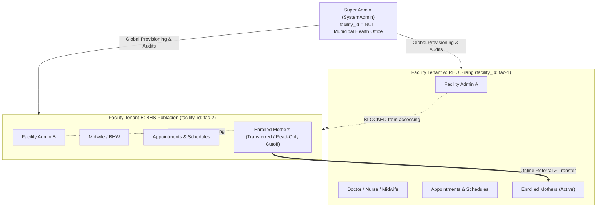
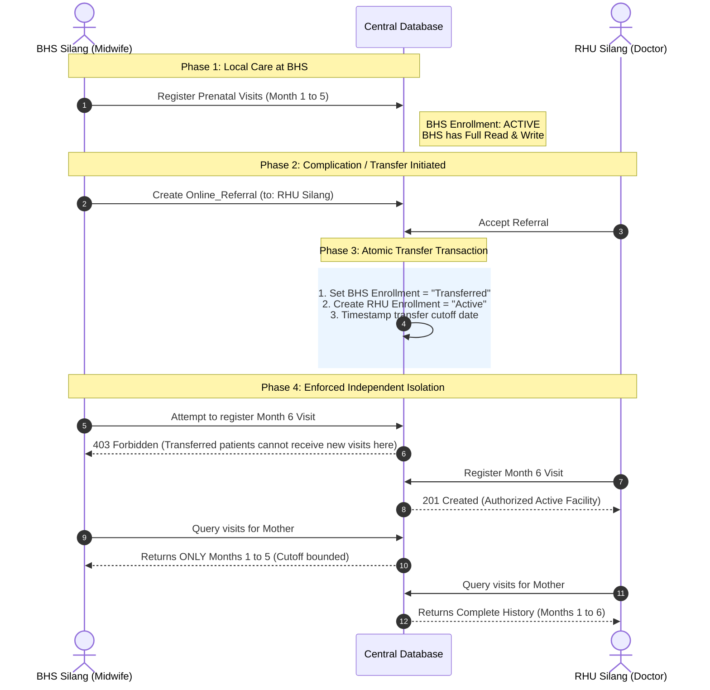

# Facility Data Isolation & Super Admin Architecture
## Architectural Solution for Independent Rural Health Units (RHU) and Barangay Health Stations (BHS)

---

## 1. Executive Summary & Panel Recommendation

### The Panel's Recommendation:
> *"Consider creating a Super Admin that manages all information stored within the system’s database. (Rethink the design of the database that manages the shared information among RHU users including admins, other rural units, etc.—to be independent)"*

### What Was the Problem?
In a municipal maternal care network, multiple health facilities operate side by side:
- **RHU (Rural Health Units):** Central municipal clinics with doctors, nurses, and medical facilities.
- **BHS (Barangay Health Stations):** Satellite primary care stations staffed by midwives and Barangay Health Workers (BHWs).
- **External Birthing Clinics / Hospitals:** Referral targets for high-risk deliveries.

Previously, clinical records (prenatal visits, laboratory screenings, supplements, appointments, and schedules) lacked strict facility access boundaries. If any healthcare worker or facility admin queried clinical records, they could view or inadvertently alter data belonging to another independent facility. Furthermore, there was no clear separation between a **Municipal Super Admin** (system administrator / Municipal Health Officer) and a **Facility Admin** (clinic supervisor).

---

## 2. Why Duplicating Records Is WRONG (Single Source of Truth)

### The Myth:
*"If facilities need to be independent, should we copy/duplicate the mother's record for each facility?"*

### The Answer: **NO. Absolutely NOT.**

In healthcare information systems, duplicating patient records across facilities causes catastrophic failures:
1. **Clinical Risk & Patient Harm:**
   - If BHS Silang records an allergy or high-risk pre-eclampsia, but RHU Silang operates on a duplicated clone that hasn't synced, doctors at the RHU will treat the patient without knowing critical life-threatening conditions.
   - Micronutrient supplementation (iron, folic acid) or Tetanus Toxoid vaccination could be administered twice if records are split.
2. **Data Desynchronization & Fragmentation:**
   - If a mother updates her phone number, address, or emergency contact at one clinic, all other copies become outdated.
3. **Database Violation (Single Source of Truth):**
   - Duplicating records violates the fundamental database principle of **Single Source of Truth (SSOT)**.

### The Correct Solution: Logical Multi-Tenancy
Instead of duplicating rows in the database, we achieve independence through **Logical Multi-Tenancy**:
- **Patient Profile:** Remains **one canonical, shared record** across the continuum of care.
- **Facility Tenancy:** Each facility is an isolated operational silo. A facility cannot see or touch a mother's record unless an explicit **care relationship** exists (either home enrollment, active referral, or delegated transfer).
- **Clinical Stamping:** Every clinical entry (visit, screening, delivery) is immutably tagged with the performing health worker and their facility.

---

## 3. The 3-Tier Multi-Tenancy Architecture



### Tier 1: Municipal Super Admin (`SystemAdmin` / `SuperAdmin`)
- **Scope:** `facility_id: null` (Global municipal scope).
- **Responsibilities:**
  - Create, update, and manage health facilities.
  - Provision and assign Facility Admins.
  - Review system-wide audit logs (`Audit_Revision_Log`).
  - View municipal aggregated maternal health statistics and epidemiology dashboards.
  - Resolve cross-facility data conflicts and transfer disputes.

### Tier 2: Independent Facility Tenants (RHU & BHS)
- **Scope:** Bound strictly to `req.user.facility_id`.
- **Responsibilities:**
  - Manage facility staff (midwives, nurses, health workers).
  - Manage local clinic appointment capacity and calendar slots (`Facility_Schedule`).
  - Access ONLY appointments and clinical records belonging to their facility's patients.
  - Prohibited by middleware from creating, updating, or deleting data belonging to other facilities (`403 Forbidden`).

### Tier 3: Patient Care Continuum (Delegated Access)
- **Canonical Models:** `Mother`, `Pregnancy`.
- **Access Gate:** `Mother_Facility_Enrollment` and `Online_Referral`.
- **Rule:** A facility can only read a mother's clinical file if:
  1. The mother's home facility matches `user.facility_id`.
  2. The facility has an active enrollment (`status: 'Active'`).
  3. The facility is the sender or receiver of an active `Online_Referral`.
- Staff from unrelated facilities receive an automatic `403 Forbidden` response.

---

## 4. What Was Implemented and How

### 1. Centralized Access Verification Engine
**File:** `services/facilityTransferAccess.js`

We introduced two enterprise-grade authorization routines:
- `verifyFacilityReadAccess(motherId, user, pregnancyId)`:
  - Validates whether the user's facility has legitimate care jurisdiction.
  - For active facilities: Grants full real-time access.
  - For transferred-out facilities: Computes the exact transfer date and returns a date cutoff filter (`lte: cutoffDate`), allowing the previous facility to view historical records for legal continuity while hiding all subsequent care.
  - For unaffiliated facilities: Immediately rejects with `403 Forbidden: "Access denied. Patient is not affiliated with your facility."`
- `verifyFacilityWriteAccess(motherId, user)`:
  - Ensures that once a mother is transferred, the originating facility's write permissions are instantly revoked.
  - Ensures that unaffiliated facilities cannot register unauthorized visits, lab results, or supplements.

### 2. Multi-Tenant Parameter Guard Middleware
**File:** `middleware/authMiddleware.js`

- `ensureFacilityAccess(paramKey)`:
  - Inspects `req.params`, `req.body`, and `req.query` for `facility_id`.
  - Automatically allows `SystemAdmin` / `SuperAdmin`.
  - Rejects cross-facility mutations from standard facility staff with `403 Forbidden`.
- `requireSuperAdmin`:
  - Protects municipal endpoints (e.g., facility creation, municipal overview) so only top-tier administrators can invoke them.

### 3. Clinical Data Protection Across Controllers
We updated every clinical controller to enforce tenant boundaries:
- **`prenatalVisitController.js`**:
  - `getAllPrenatalVisits`: Automatically scopes results to `req.user.facility_id` for facility users, while allowing Super Admin to view municipal-wide records.
  - `getAllPrenatalVisitByFacility`: Validates that the caller belongs to the requested facility or is a Super Admin.
  - `getPrenatalVisitById`: Uses `verifyFacilityReadAccess` and applies transfer date boundaries.
- **`labScreeningController.js`**:
  - Enforces `verifyFacilityReadAccess` on `getLabScreeningById`, `getLabScreeningByPregnancy`, and `getLabScreeningByMother`.
  - Enforces `verifyFacilityWriteAccess` on `registerLabScreening`.
- **`supplementController.js`**:
  - Enforces `verifyFacilityReadAccess` on `getSupplementRecordByID`, `getSupplementRecordByPregnancy`, and `getSupplementRecordByMother`.
  - Enforces `verifyFacilityWriteAccess` on `registerSupplementRecord`.
- **`deliveryOutcomeController.js` & `postpartumVisitController.js`**:
  - Prevents registering delivery outcomes and postpartum visits unless the facility has active write access.
  - Applies transfer cutoff boundaries to postpartum visit lookups.
- **`ehrController.js`**:
  - Verifies that when document attachments are queried for a specific mother, the requesting facility has verified access.
- **`appointmentController.js`**:
  - Scopes `getAllAppointments`:
    - Mothers only see their own appointments (`user_id = req.user.user_id`).
    - Facility staff only see appointments booked at their facility (`facility_id = req.user.facility_id`).
    - Super Admins can see all appointments or filter by facility.
- **`calendarController.js` & `calendarRouter.js`**:
  - Protects appointment capacity slots (`/slots`) with `ensureFacilityAccess('facility_id')`, ensuring Facility A cannot alter Facility B's calendar.

---

## 5. How Inter-Facility Referrals & Transfers Work



1. **Before Transfer:** BHS Silang has full read and write access. RHU Silang has zero access.
2. **Transfer Event:** Upon referral acceptance, an atomic transaction transitions BHS to `Transferred` and RHU to `Active`.
3. **After Transfer:** 
   - BHS write access is instantly locked.
   - BHS read access is bounded: they can review visits they performed up to the transfer date (for clinical audit), but cannot see subsequent care at RHU.
   - RHU receives full read and write access.
   - Third-party facilities have zero access.

---

## 6. Verification & Automated Test Evidence

The backend test suite (`scripts/test-transfer-and-superadmin.js`) tests this architecture automatically.

### Test Results:
```
============================================================
🧪 RUNNING COMPREHENSIVE BACKEND VERIFICATION SUITE
Coverage: SuperAdmin Tier, Multi-tenant Scoping, & Transfer Bounds
============================================================

--- 1. Testing SuperAdmin & Role Verification Middleware ---
  ✅ PASS: isSuperAdmin recognises SystemAdmin
  ✅ PASS: isSuperAdmin recognises SuperAdmin
  ✅ PASS: isSuperAdmin rejects facility Admin
  ✅ PASS: isSuperAdmin rejects HealthWorker
  ✅ PASS: checkUserRole passes SystemAdmin
  ✅ PASS: checkUserRole normalizes SuperAdmin to match SystemAdmin
  ✅ PASS: checkUserRole denies facility Admin for SystemAdmin-only routes with 403

--- 2. Setting up Test Data in DB ---
  -> Test facilities and patient records generated.

--- 3. Testing Pre-Transfer Care Phase (Month 1-5) ---
  ✅ PASS: Prenatal visit for Month 2 recorded by Facility A
  ✅ PASS: Facility A staff has write access while Active

--- 4. Executing Referral Transfer (Facility A -> Facility B) ---
  ✅ PASS: Originating Facility A enrollment changed to "Transferred"
  ✅ PASS: Receiving Facility B enrollment created with status "Active"

--- 5. Testing Post-Transfer Write Guard ---
  ✅ PASS: Facility A staff write access is BLOCKED after transfer
  ✅ PASS: Facility B staff write access is ALLOWED after transfer
  ✅ PASS: Facility B successfully registered Month 6 visit

--- 6. Testing Scoped Query Filtering (Months 1-5 vs Month 6+) ---
  ✅ PASS: Facility A receives date cutoff filter bounded to transfer date
  ✅ PASS: Facility A ONLY sees Month 2 visit (1 visit total, Month 6 is hidden)
  ✅ PASS: Facility B has NO cutoff filter (full access)
  ✅ PASS: Facility B sees ALL visits (Month 2 from Facility A + Month 6 from Facility B)
  ✅ PASS: SuperAdmin has NO cutoff filter (sees complete audit trail)

--- 7. Testing Independent Multi-Tenant Isolation & Access Guards ---
  ✅ PASS: Unaffiliated Facility C worker is BLOCKED from reading patient data
  ✅ PASS: Unaffiliated Facility C worker is BLOCKED from writing patient data
  ✅ PASS: SuperAdmin has unrestricted global read access
  ✅ PASS: Active Facility B has full read access
  ✅ PASS: Transferred Facility A has cutoff-bounded read access
  ✅ PASS: ensureFacilityAccess blocks Facility A from mutating Facility B data with 403
  ✅ PASS: ensureFacilityAccess permits SuperAdmin cross-facility management

============================================================
RESULTS: 26/26 Passed (0 Failed)
============================================================
```

---

## 7. Panel Defense Guide: How to Defend This Solution

When your panel asks:
> *"How did you address our recommendation to make the shared database independent and create a Super Admin?"*

### Recommend Response:
1. **Explain the Super Admin Tier:**
   > *"We established a clear dual-tier administration. The **Super Admin** operates at the municipal level without being tied to any single facility (`facility_id = null`). They handle facility onboarding, account provisioning, municipal health statistics, and system audit trails. In contrast, **Facility Admins** are strictly isolated to their own facility."*

2. **Explain Why Records Were NOT Duplicated:**
   > *"We specifically avoided duplicating patient records across facilities. In healthcare informatics, duplicating patient profiles creates data fragmentation, desynchronization, and serious medical safety risks (such as duplicate vaccinations or conflicting risk diagnoses). Instead, we maintain a **Single Source of Truth** for each mother."*

3. **Explain How Facility Independence Is Enforced:**
   > *"We implemented **Logical Multi-Tenancy**. Each RHU and BHS operates independently:
   > - Local schedules, appointments, and staff are strictly isolated by `facility_id`.
   > - Patient records are protected by access guards (`verifyFacilityReadAccess` and `verifyFacilityWriteAccess`).
   > - A facility cannot view or edit any patient unless there is an active enrollment or approved referral.
   > - When a patient transfers, the past facility's write access is revoked, and read access is automatically capped at the transfer date cutoff."*

